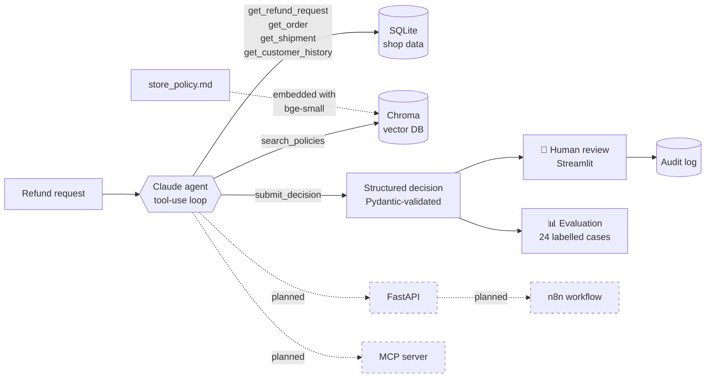

# 🧾 Refund Review Agent

[](https://github.com/julianehren/refund-review-agent/actions/workflows/ci.yml)


An AI agent that reviews e-commerce refund requests the way an experienced customer-service agent would: it **looks up the facts itself** (order, shipment, customer history), **retrieves the applicable rules** from the shop's refund policy via RAG, and **recommends APPROVE, REJECT or ESCALATE** with a cited justification. A **human makes the final call** in a review UI, and every run is **measured** against labelled test cases.

> **Why this project?** I ran Amazon private-label brands for several years and handled refund, return and A-to-z claims by hand. This agent automates exactly that workflow – and the pattern *request → gather facts → retrieve rules → justified recommendation → human approval* transfers directly to card chargebacks in banking, insurance claims or AML alert triage.

<!-- RESULTS_START -->
<!-- RESULTS_END -->

---

## How it works



1. **Tool use (agentic loop).** Claude receives the request id and decides on its own which tools to call and in which order. The loop is written by hand on the Anthropic Messages API (no framework), so every step is transparent.
2. **RAG over the policy.** The 13-section refund policy is split into sections, embedded locally (`BAAI/bge-small-en-v1.5` via fastembed – no extra API key) and stored in Chroma. The agent searches it semantically: *"pan arrived dented"* finds *§5 Damaged in transit*.
3. **Structured output.** The final answer is a `submit_decision` tool call validated by Pydantic (decision, confidence, key facts, cited sections, draft customer reply). Invalid output is sent back to the model to correct itself.
4. **Grounding check.** The agent may only cite policy sections it actually retrieved – otherwise the UI shows a warning and the evaluation counts it.
5. **Human-in-the-loop.** The Streamlit UI shows recommendation, facts, cited rules, cost and the full tool trace. The reviewer accepts or overrides (overrides require a note); everything lands in an audit table.
6. **Evaluation.** 24 synthetic cases, one per rule incl. edge cases (day 14 vs. day 15), with labels stored *outside* the database so the agent cannot see them.

## What it shows

| Concept | Where |
|---|---|
| Agentic workflow / tool use / function calling | [`agent.py`](src/refund_agent/agent.py), [`tools.py`](src/refund_agent/tools.py) |
| RAG: embeddings, vector database, semantic search | [`knowledge.py`](src/refund_agent/knowledge.py) |
| Structured outputs & self-correction | [`models.py`](src/refund_agent/models.py), `submit_decision` in `agent.py` |
| Human-in-the-loop, four-eyes principle, audit log | [`app/streamlit_app.py`](app/streamlit_app.py) |
| LLM evaluation, KPIs, cost & latency tracking | [`evals/run_eval.py`](evals/run_eval.py) |
| SQL data modelling with constraints | [`schema.sql`](src/refund_agent/schema.sql) |
| Testing (no API key needed) & CI/CD | [`tests/`](tests), [GitHub Actions](.github/workflows/ci.yml) |

## Quickstart

Requirements: Python 3.11+ and an [Anthropic API key](https://console.anthropic.com) (a full evaluation run with Haiku costs a few cents).

```bash
git clone https://github.com/julianehren/refund-review-agent.git
cd refund-review-agent

python -m venv .venv
source .venv/bin/activate          # Windows: .venv\Scripts\activate
pip install -e ".[dev]"

cp .env.example .env               # Windows: copy .env.example .env
# open .env and paste your ANTHROPIC_API_KEY

python -m refund_agent.seed        # create the demo database (24 open requests)
```

Then:

```bash
streamlit run app/streamlit_app.py           # review UI in the browser
python -m refund_agent.agent R-1003 R-1014   # run the agent in the terminal
python evals/run_eval.py                     # evaluate on all 24 labelled cases
pytest                                       # run the tests
python scripts/try_rag.py "parcel never arrived"   # try the policy search
```

The first start downloads the embedding model (~130 MB) once.

## Project structure

```
src/refund_agent/
├── agent.py        # the agentic loop: Claude ↔ tools until submit_decision
├── tools.py        # database tools (pure Python, reusable by API/MCP later)
├── knowledge.py    # RAG: policy chunking, embeddings, Chroma search
├── models.py       # Pydantic models for decision, trace and result
├── seed.py         # synthetic shop data + 24 labelled cases
├── schema.sql      # SQLite schema
└── config.py       # paths, model, prices, simulation date
app/streamlit_app.py   # human-in-the-loop review UI
evals/run_eval.py      # evaluation & report
data/store_policy.md   # the refund policy (knowledge base)
tests/                 # pytest suite with fake LLM client
```

## Design decisions

- **Dates are computed in code, not by the LLM.** Tools return ready-made numbers such as `days_from_delivery_to_request`. LLMs are unreliable at counting days; Python is not.
- **Tools don't know about the LLM.** `tools.py` contains plain functions plus JSON schemas. The same functions can be exposed via a REST API or an MCP server without changes (see roadmap).
- **Hand-written loop instead of LangChain.** For a single agent with five tools a framework adds more abstraction than value; writing the loop makes tool dispatch, error handling and token accounting explicit.
- **"When in doubt, escalate".** The policy and prompt make ESCALATE the safe default. The evaluation tracks *wrong approvals* separately, because paying out money wrongly is the costliest error.
- **Local embeddings.** No second API key, no data leaves the machine for retrieval, and the index rebuilds automatically when the policy file changes.
- **Labels live outside the database** (`evals/labels.json`), so the agent can't access the expected answers.
- **Synthetic data.** All customers, orders and rules are invented. The focus of this project is wiring the components into a working, measurable system – the policy could just as well have 1,000 pages.

## Roadmap

- [x] **v1.0** – Tool-use agent, RAG over policy, structured output, human-in-the-loop UI, evaluation, tests, CI
- [ ] **v1.1** – REST API with FastAPI (`POST /reviews`), so other systems can call the agent
- [ ] **v1.2** – MCP server exposing the same tools to Claude Desktop and other MCP clients
- [ ] **v1.3** – n8n workflow: new request → agent review → notification to the reviewer
- [ ] **v1.4** – Docker image and hosted demo
- [ ] Ideas: prompt caching to cut cost, LLM-as-judge for reply quality, more cases incl. adversarial customer messages

## How I built this

I built this project over a weekend in close collaboration with Claude as a pair-programming partner (agentic coding): I defined the use case, the rules and test cases from my e-commerce experience, made the architecture decisions together with Claude, and reviewed, ran and tested every component. Commits co-authored by Claude are marked as such.

## License

MIT – see [LICENSE](LICENSE).
