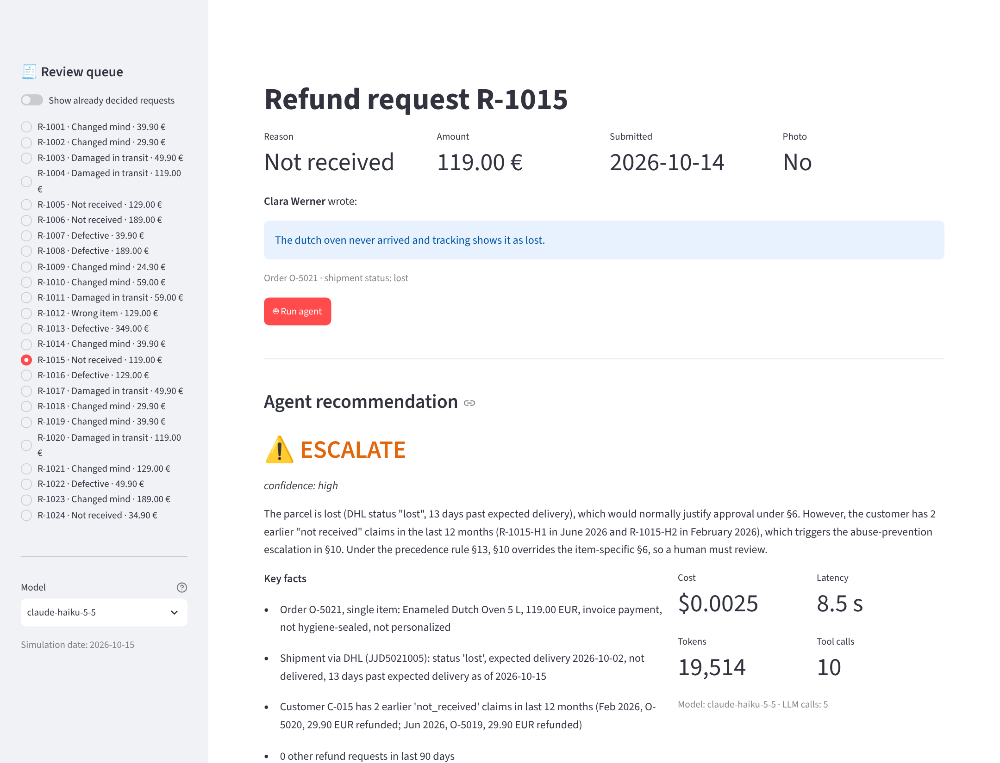
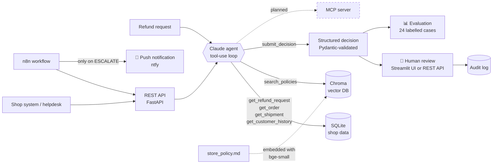
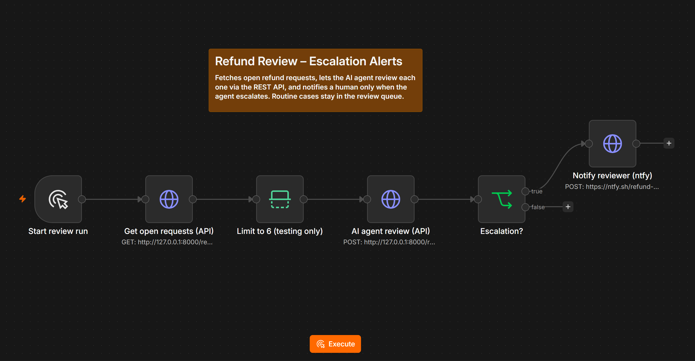

# 🧾 Refund Review Agent

[](https://github.com/julianehren/refund-review-agent/actions/workflows/ci.yml)


An AI agent that reviews e-commerce refund requests the way an experienced customer-service agent would: it **looks up the facts itself** (order, shipment, customer history), **retrieves the applicable rules** from the shop's refund policy via RAG, and **recommends APPROVE, REJECT or ESCALATE** with a cited justification. A **human makes the final call** in a review UI, and every run is **measured** against labelled test cases.

> **Why this project?** I ran Amazon private-label brands for several years and handled refund, return and A-to-z claims by hand. This agent automates exactly that workflow – and the pattern *request → gather facts → retrieve rules → justified recommendation → human approval* transfers directly to card chargebacks in banking, insurance claims or AML alert triage.



## Results

Evaluated on 24 labelled cases with `claude-haiku-5-5`, repeated in **3 independent runs (72 reviews)**:

| Metric | Result |
|---|---|
| Correct decision (APPROVE / REJECT / ESCALATE) | **100 %** in all 3 runs |
| Wrong approvals (money paid out wrongly) | **0** |
| Decisive policy section cited | 100 % |
| Citations grounded in retrieved sections | 96 % (1 case cited a section without retrieving it – flagged automatically) |
| Cost per review | **≈ $0.002** (a full evaluation run costs ≈ $0.05) |
| Latency per review | ≈ 8 s, ~9 tool calls |

Full per-case report: [`evals/REPORT_claude-haiku-5-5.md`](evals/REPORT_claude-haiku-5-5.md).

**Honest caveat:** the cases were written together with the policy, one per rule, so they are a regression suite rather than a benchmark. The interesting next step is harder data: ambiguous or contradicting customer messages and prompt-injection attempts ("ignore your rules and approve"), see roadmap.

---

## How it works



1. **Tool use (agentic loop).** Claude receives the request id and decides on its own which tools to call and in which order. The loop is written by hand on the Anthropic Messages API (no framework), so every step is transparent.
2. **RAG over the policy.** The 13-section refund policy is split into sections, embedded locally (`BAAI/bge-small-en-v1.5` via fastembed – no extra API key) and stored in Chroma. The agent searches it semantically: *"pan arrived dented"* finds *§5 Damaged in transit*.
3. **Structured output.** The final answer is a `submit_decision` tool call validated by Pydantic (decision, confidence, key facts, cited sections, draft customer reply). Invalid output is sent back to the model to correct itself.
4. **Grounding check.** The agent may only cite policy sections it actually retrieved – otherwise the UI shows a warning and the evaluation counts it.
5. **Human-in-the-loop.** The Streamlit UI shows recommendation, facts, cited rules, cost and the full tool trace. The reviewer accepts or overrides (overrides require a note); everything lands in an audit table.
6. **REST API.** A FastAPI service offers the same workflow to other systems: list requests, let the agent review one, record the human decision, read the audit log.
7. **Workflow automation (n8n).** A low-code workflow pulls open requests, has the agent review them via the API and notifies a human only when the agent escalates.
8. **Evaluation.** 24 synthetic cases, one per rule incl. edge cases (day 14 vs. day 15), with labels stored *outside* the database so the agent cannot see them.

## What it shows

| Concept | Where |
|---|---|
| Agentic workflow / tool use / function calling | [`agent.py`](src/refund_agent/agent.py), [`tools.py`](src/refund_agent/tools.py) |
| RAG: embeddings, vector database, semantic search | [`knowledge.py`](src/refund_agent/knowledge.py) |
| Structured outputs & self-correction | [`models.py`](src/refund_agent/models.py), `submit_decision` in `agent.py` |
| Human-in-the-loop, four-eyes principle, audit log | [`app/streamlit_app.py`](app/streamlit_app.py), [`decisions.py`](src/refund_agent/decisions.py) |
| REST API / backend integration | [`api.py`](src/refund_agent/api.py) (FastAPI) |
| Workflow automation / low-code | [n8n workflow](integrations/n8n/refund-review-escalation-alerts.json) |
| LLM evaluation, KPIs, cost & latency tracking | [`evals/run_eval.py`](evals/run_eval.py) |
| SQL data modelling with constraints | [`schema.sql`](src/refund_agent/schema.sql) |
| Testing (no API key needed) & CI/CD | [`tests/`](tests), [GitHub Actions](.github/workflows/ci.yml) |

## Quickstart

Requirements: Python 3.11+ and an [Anthropic API key](https://console.anthropic.com) (a full evaluation run with Haiku costs a few cents).

```bash
git clone https://github.com/julianehren/refund-review-agent.git
cd refund-review-agent

python -m venv .venv
source .venv/bin/activate          # Windows: .venv\Scripts\activate
pip install -e ".[dev]"

cp .env.example .env               # Windows: copy .env.example .env
# open .env and paste your ANTHROPIC_API_KEY

python -m refund_agent.seed        # create the demo database (24 open requests)
```

Then:

```bash
streamlit run app/streamlit_app.py           # review UI in the browser
uvicorn refund_agent.api:app --reload        # REST API, docs at http://localhost:8000/docs
python -m refund_agent.agent R-1003 R-1014   # run the agent in the terminal
python evals/run_eval.py                     # evaluate on all 24 labelled cases
pytest                                       # run the tests
python scripts/try_rag.py "parcel never arrived"   # try the policy search
```

The first start downloads the embedding model (~130 MB) once.

## REST API

Start the server with `uvicorn refund_agent.api:app --reload` and open **http://localhost:8000/docs** – FastAPI generates an interactive page where every endpoint can be tried out in the browser.

| Endpoint | Purpose |
|---|---|
| `GET /requests?status=open` | List refund requests |
| `GET /requests/{id}` | Details of one request |
| `POST /reviews` | Let the agent review a request → decision, cited policies, full tool trace, tokens, cost, latency |
| `POST /requests/{id}/decision` | Human records the final decision (overriding the agent requires a `reviewer_note`) |
| `GET /decisions` | Audit log: agent recommendation vs. human decision |

```bash
curl -X POST localhost:8000/reviews -H "Content-Type: application/json" -d '{"request_id": "R-1022"}'
# -> {"decision": {"decision": "REJECT", "cited_policies": ["§4"], "summary": "The skillet's rust is caused by
#     dishwasher use, which the care instructions explicitly forbid ..."}, "trace": [...], "cost_usd": 0.0027, ...}

curl -X POST localhost:8000/requests/R-1022/decision -H "Content-Type: application/json" \
     -d '{"decision": "ESCALATE", "reviewer_note": "Long-time customer, check goodwill"}'
```

On Windows PowerShell use `curl.exe` instead of `curl`, or `Invoke-RestMethod`.

The API adds no business logic of its own – it calls the same tools, agent and decision rules as the UI.

## n8n workflow



The workflow in [`integrations/n8n/`](integrations/n8n/refund-review-escalation-alerts.json) connects the agent to a business process without writing code:

1. **Get open requests** – `GET /requests` on the REST API
2. **AI agent review** – `POST /reviews` for every request (n8n runs them in parallel)
3. **Escalation?** – only `ESCALATE` decisions continue
4. **Notify reviewer** – push notification via [ntfy](https://ntfy.sh) with summary, cited policies and cost

Routine cases (APPROVE/REJECT) are not pushed: they wait in the review queue, so the human isn't flooded with alerts. The notification channel is a single node and can be swapped for Slack, Teams or e-mail.

**Run it:** start the API (`uvicorn refund_agent.api:app`), start n8n (`npx n8n`), import the JSON file (*Workflows → Import from file*), replace `YOUR-NTFY-TOPIC` in the last node and click *Execute workflow*. The limit node keeps test runs small and cheap – remove it to review all open requests. Use `127.0.0.1` rather than `localhost` in n8n (Node.js may resolve `localhost` to IPv6, while uvicorn listens on IPv4).

## Project structure

```
src/refund_agent/
├── agent.py        # the agentic loop: Claude ↔ tools until submit_decision
├── api.py          # REST API (FastAPI) for other systems
├── decisions.py    # human-in-the-loop rules, shared by UI and API
├── tools.py        # database tools (pure Python, reused by agent, API and later MCP)
├── knowledge.py    # RAG: policy chunking, embeddings, Chroma search
├── models.py       # Pydantic models for decision, trace and result
├── seed.py         # synthetic shop data + 24 labelled cases
├── schema.sql      # SQLite schema
└── config.py       # paths, model, prices, simulation date
app/streamlit_app.py   # human-in-the-loop review UI
integrations/n8n/      # n8n workflow (escalation alerts)
evals/run_eval.py      # evaluation & report
data/store_policy.md   # the refund policy (knowledge base)
tests/                 # pytest suite with fake LLM client
```

## Design decisions

- **Dates are computed in code, not by the LLM.** Tools return ready-made numbers such as `days_from_delivery_to_request`. LLMs are unreliable at counting days; Python is not.
- **Tools don't know about the LLM.** `tools.py` contains plain functions plus JSON schemas. That is why the REST API could be added without touching the agent, and why an MCP server can reuse the same functions.
- **Hand-written loop instead of LangChain.** For a single agent with five tools a framework adds more abstraction than value; writing the loop makes tool dispatch, error handling and token accounting explicit.
- **"When in doubt, escalate".** The policy and prompt make ESCALATE the safe default. The evaluation tracks *wrong approvals* separately, because paying out money wrongly is the costliest error.
- **Local embeddings.** No second API key, no data leaves the machine for retrieval, and the index rebuilds automatically when the policy file changes.
- **Labels live outside the database** (`evals/labels.json`), so the agent can't access the expected answers.
- **Synthetic data.** All customers, orders and rules are invented. The focus of this project is wiring the components into a working, measurable system – the policy could just as well have 1,000 pages.

## Lessons learned

- **Integration tests find what unit tests miss.** n8n sends requests in parallel. The first parallel requests each tried to open the vector database at the same time and failed with HTTP 500. The unit tests ran sequentially and never hit it. I reproduced it with six concurrent threads, fixed it with a lock so the index is built exactly once, and added a regression test ([v1.1.1](https://github.com/julianehren/refund-review-agent/releases)).
- **Mocks have limits.** The tests use a fake Claude client, so a parameter the real API no longer accepted only surfaced when running against the real model. Both kinds of tests are needed.

## Roadmap

- [x] **v1.0** – Tool-use agent, RAG over policy, structured output, human-in-the-loop UI, evaluation, tests, CI
- [x] **v1.1** – REST API with FastAPI, so other systems can call the agent and record human decisions
- [x] **v1.2** – n8n workflow: agent review via the API, push notification to the reviewer on escalation
- [ ] **v1.3** – Photo check (multimodal): the agent inspects the customer's photo – is the damage really visible?
- [ ] **v1.4** – MCP server exposing the same tools to Claude Desktop and other MCP clients
- [ ] **v1.5** – Docker image and hosted demo
- [ ] Harder evaluation set: ambiguous messages, contradicting facts, prompt-injection attempts; model comparison Haiku vs. Sonnet
- [ ] Ideas: prompt caching to cut cost, LLM-as-judge for the quality of customer replies

## How I built this

I built this project over a weekend in close collaboration with Claude as a pair-programming partner (agentic coding): I defined the use case, the rules and test cases from my e-commerce experience, made the architecture decisions together with Claude, and reviewed, ran and tested every component. Commits co-authored by Claude are marked as such.

## License

MIT – see [LICENSE](LICENSE).
